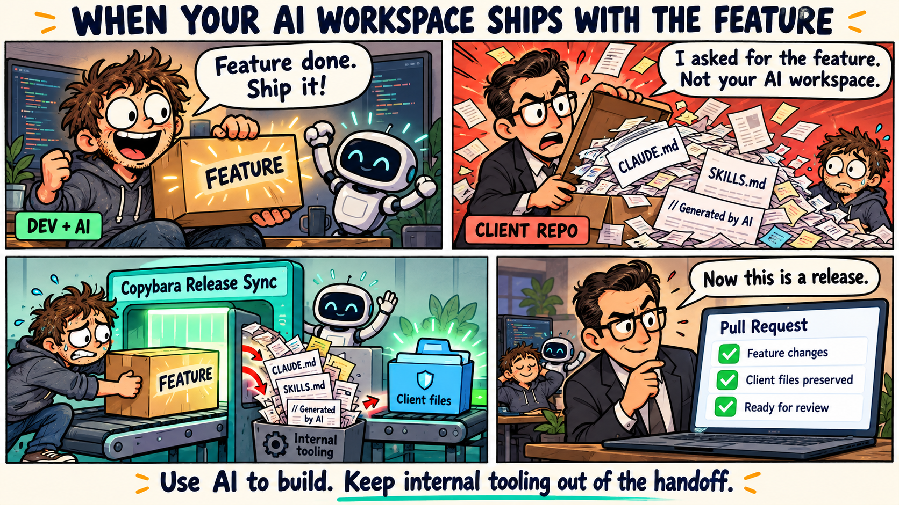
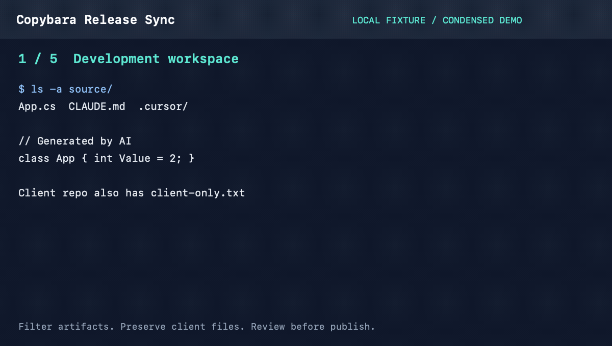

# Copybara Release Sync — Clean handoffs for AI-assisted teams

[](https://github.com/bentran1vn/copybara-release-sync/actions/workflows/ci.yml)
[](LICENSE)
[](#optional-ai-cleanup)
[](#optional-ai-cleanup)

Filter `CLAUDE.md`, `AGENTS.md`, `.cursor/`, skill files and Copilot instructions from source imports, then remove newly introduced comments before shipping to client repositories.

**Workspace hygiene for AI-assisted development:** preserve client-only files, inspect the release diff, and publish deliberately. Built on [Google Copybara](https://github.com/google/copybara) and Roslyn. Currently focused on **C#/.NET**; [TypeScript support is planned](docs/roadmap/typescript.md).

AI is optional. The default workflow needs no model API calls or tokens. Cleanup is a delivery policy, not proof of authorship or a substitute for disclosure, required attribution, or code review.

## The problem

Your team uses AI to build features. Your client wants the deliverable without AI workspace artifacts: no `CLAUDE.md`, skill instructions, or “Generated by AI” comments arriving with the feature. Copying the development repository directly can ship those artifacts—and accidentally delete files maintained only by the client.



Copybara Release Sync prepares a filtered release, preserves destination-only files, and gives maintainers a diff and editable release notes to review before publishing.

## 15-second demo



Condensed playback of a real local fixture run, not a speed benchmark. No client code, AI provider call, or remote push is used. [Reproduce the demo](docs/demo/README.md).

## Before / after

| In development or destination | In the prepared release |
| --- | --- |
| Source `CLAUDE.md`, `AGENTS.md`, `.claude/`, `.codex/`, `.cursor/` | Excluded from source imports |
| Source `SKILL.md`, `SKILLS.md`, `skill-sources.json` | Excluded from source imports |
| Source Copilot instructions and `.github/` workflows | Source versions excluded; destination `.github/` preserved |
| Source `results/` artifacts | Not imported |
| New comments, including “Generated by AI” | Removed in supported formats; uncertain syntax stops the workflow |
| Existing matching client comments | Retained by content and occurrence count |
| Files maintained only in the client repo | Preserved, including executable mode and symlinks |
| New application code | Included in the local diff for review |

The comment policy removes **all new comments**, not just AI-labelled text. Filters do not purge files already present in the client repository. Review required legal notices and configure protected paths appropriately.

## Why not just…

| Approach | Useful for | What this workflow adds |
| --- | --- | --- |
| Copy files manually | One-off transfers | Repeatable filtering, destination-file protection, comment checks and an explicit PR step |
| `.gitignore` | Keeping untracked files out of Git | A separate release policy for already-tracked source files; `.gitignore` does not affect tracked files ([Git docs](https://git-scm.com/docs/gitignore)) |
| `git filter-repo` | Rewriting repository history ([project docs](https://github.com/newren/git-filter-repo)) | A recurring source-to-destination handoff with preserved client files and local review |
| Copybara alone | Configurable repository migration | A wrapper adding comment policy checks, destination-file restoration and editable PR notes |

## Workflow

1. Fetch the destination and migrate source changes into a local review branch.
2. Restore destination files that would otherwise be deleted.
3. Remove newly introduced comments while retaining matching destination comments.
4. Optionally run an AI cleanup on changed fragments, then re-check comments.
5. Generate editable release notes and stop for review.
6. On an explicit `--push`, re-check the destination and open a pull request.

The default workflow does **not** call an AI provider. It does not publish until you request `--push` (or explicitly opt into `--auto`). The source repository is not modified. Files present on both sides can still be overwritten by source changes: review the resulting diff.

## Requirements

- Bash, Python 3, Git supporting `git init --ref-format=files`
- Java 25+ for the default Copybara release (Java 21–24 selects the configured older release)
- .NET SDK 9 for C# comment parsing
- Ruby with YAML/JSON support for configuration validation
- GitHub CLI (`gh`) and Git authentication for opening PRs
- Optional: an authenticated Codex or Claude Code CLI

Docker is not required. macOS, Linux and WSL are the intended environments. The PowerShell launcher delegates to Bash/WSL.

## Configure

Edit `.copybara/copy.bara.sky`:

- Replace the example repository URLs and branch names in `REPOS`.
- Set `DEFAULT_AUTHOR` to your authorized release identity. `AUTHOR_MAP` is optional.
- Configure `source_exclude` for private/local files.
- Configure `dest_keep` for destination paths that must never be overwritten; `.github/**` is protected by default.

The example configuration is not connected to a real project. Review all patterns before using it. This is not a secret scanner: nested environment files and other secrets need explicit exclusion rules or an independent scanner.

Optional environment settings are documented in `.copybara/local.env.example`. Never commit credentials or your `local.env`.

## First release

When no matching migration baseline exists, use a squash import:

```bash
./.copybara/sync-local.sh backend --squash
```

The script prints the review directory and the release-notes file. Inspect both. Then:

```bash
./.copybara/sync-local.sh backend --push
```

Merge with **Rebase and merge** or **Create a merge commit** so the `GitOrigin-RevId` trailer remains available. If using another merge strategy, retain the trailer explicitly and verify the next migration baseline.

## Later releases

After the first migration is merged:

```bash
./.copybara/sync-local.sh backend
# Review the diff and generated PR description.
./.copybara/sync-local.sh backend --push
```

Branches use `release/YYYY-MM-DD-HHMMSS`. Generated release notes describe changed modules, not verified new behavior; edit them before publishing.

## Optional AI cleanup

```bash
AI_MAX_FILES=2000 AI_MODEL=YOUR_MODEL AI_EFFORT=xhigh \
  ./.copybara/sync-local.sh backend --ai codex
```

Use `--ai claude` for Claude Code. Choose a model available in your CLI/account. AI is optional and may consume substantial quota. Changed fragments and nearby context are placed in a temporary workspace after comment filtering. This workspace is **not** a filesystem read-isolation boundary. Do not assume it prevents a CLI from reading files outside that directory.

The AI guard is heuristic and does not prove semantic correctness. Review output and use `TEST_CMD` when appropriate. Do not remove legal attribution or required notices; review applicable licenses and preserve necessary files through `dest_keep` or a project-specific policy.

## File and comment policies

- Files missing from the source are restored from the destination, including source deletions and renames. Renames can therefore retain both old and new paths. Deletions require a separate, intentional workflow.
- File/directory collisions stop the migration rather than overwriting preserved files.
- A pre-push check rejects destination-file deletions, including changes introduced after the local sync.
- C# comments are parsed with Roslyn; cleanup compares executable token streams before and after.
- Python uses tokenization; supported configuration/script formats have additional content checks.
- Directives, shebangs and string data are not comments. Python docstrings remain executable string expressions.
- Unsupported formats or uncertain syntax stop the workflow. This version is **not** a universal JavaScript/TypeScript or multi-language comment cleaner.
- Matching pre-existing comments are retained by content and occurrence count, not exact location.
- Source filters stop importing internal AI configuration and generated `results/` artifacts. The destination-file preservation policy still retains such files if already present in the destination.

To clean an existing local review without another sync or AI call:

```bash
./.copybara/sync-local.sh backend --clean-comments
```

If cleanup fails, some independently verified edits may remain uncommitted. Inspect the report and working tree before retrying. Do not bypass the guard blindly.

## Roadmap

- [ ] [TypeScript / JavaScript parser support](docs/roadmap/typescript.md) — planned, not available yet.
- [ ] Regression fixtures for JSX, template literals, regexes and JSDoc.

Want JS/TS support? [Find or discuss the roadmap issue](https://github.com/bentran1vn/copybara-release-sync/issues?q=is%3Aissue%20TypeScript) and share a minimal example. Contributions and reactions help prioritize work.

## Tests

```bash
python3 -B -m unittest discover -s .copybara/tests -p 'test_*.py'
bash -n .copybara/sync-local.sh .copybara/ai_cleanup.sh
python3 .copybara/cfg.py .copybara/copy.bara.sky check
dotnet build .copybara/comment-cleaner/CommentCleaner.csproj
```

Tests use temporary local repositories and mock AI execution. CI does not sync repositories or publish changes.

## License

MIT for this project's code. Copybara, Git, .NET/Roslyn and provider CLIs retain their own licenses. They are not bundled here.
